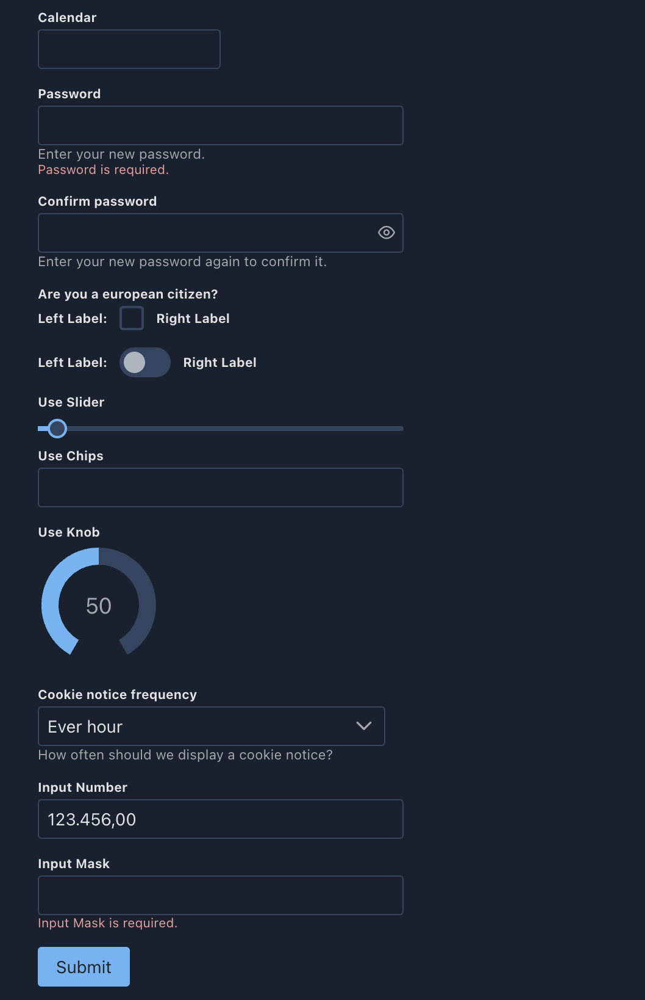

# Formkit - Primevue

PrimeVue based [FormKit Inputs](https://sfxcode.github.io/formkit-primevue/guide/inputs.html) for using [FormKit](https://formkit.com/) with the [PrimeVue UI Framework](https://primevue.org/#/).

Main focus of this project is to provide configuration based forms with validation.

In addition, you can use the same pattern for **data output** from **schema** using [PrimeOutputs](https://sfxcode.github.io/formkit-primevue/guide/outputs.html).

## PrimeVue Versions

Actual PrimeVue Version of the main branch is *4.5.5.*

This is the last version of the 4.x branch. Starting with [PrimeVue's "Next Chapter"](https://primeui.dev/nextchapter), newer versions are no longer open source, so 5.x and later will not be supported. Dependency overrides pin PrimeVue-related packages to their last MIT-licensed versions.

## Alternative: formkit-openvue

[sfxcode/formkit-openvue](https://github.com/sfxcode/formkit-openvue) provides OpenVue based FormKit inputs. It is the natural successor if you want to keep the schema-driven form approach of this project on a fully open source component base, independent of PrimeVue's licensing changes.

[Docs](https://sfxcode.github.io/formkit-openvue/) | [Demo/Playground](https://formkit-openvue.netlify.app/)

## Alternative: nuxt-ui-formkit

[sfxcode/nuxt-ui-formkit](https://github.com/sfxcode/nuxt-ui-formkit) integrates FormKit form handling with [Nuxt UI](https://ui.nuxt.com/) components for Nuxt 4. Choose it if your application is built on Nuxt UI instead of PrimeVue.

[Docs](https://sfxcode.github.io/nuxt-ui-formkit/) | [Demo/Playground](https://nuxt-ui-formkit.netlify.app/)

## Build

[](https://github.com/sfxcode/formkit-primevue/actions/workflows/deploy.yml)

[](https://app.netlify.com/sites/formkit-primevue/deploys)

## Docs

[Docs](https://sfxcode.github.io/formkit-primevue/)

[Demo/Playground](https://formkit-primevue.netlify.app/)

## Usage

### Configuration

Add *formkit.config.ts*

```typescript
import { defaultConfig, plugin } from '@formkit/vue'
import { primeInputs } from '@sfxcode/formkit-primevue'

app.use(plugin, defaultConfig({
  locales: { de, en },
  // Define the active locale
  locale: 'en',
  inputs: primeInputs, 
}))
```

or if using also the output part

```typescript
import { defaultConfig, plugin } from '@formkit/vue'
import { primeInputs, primeOutputs } from '@sfxcode/formkit-primevue'

app.use(plugin, defaultConfig({
  locales: { de, en },
  // Define the active locale
  locale: 'en',
    inputs: { ...primeInputs, ...primeOutputs },
}))
```

Important: output elements depends on vue-i18n to style numbers, dates, ...

### Nuxt

[FormKit-PrimeVue-Nuxt](https://github.com/sfxcode/formkit-primevue-nuxt) module available.

Features:

- add PrimeVue Nuxt Module
- add FormKit Nuxt Module
- add i18n Nuxt Module
- Default Configuration for FormKit (with PrimeVue components) is provided (can be disabled if needed)
- AutoImport of PrimeVue Form Components
- PrimeIcons are loaded by Default
- FormKit Styling of this package is loaded by default
- AutoImport of Composables
- AutoImport of Components

## Limitations

Prefixing of the PrimeVue component names is not supported.

### Schema Helper Functions

[useFormKitSchema](https://github.com/sfxcode/formkit-primevue/blob/main/src/composables/useFormKitSchema.ts) provide functions to simplify the usage of elements, components, lists, ...

[useInputEditorSchema](https://github.com/sfxcode/formkit-primevue/blob/main/src/composables/useInputEditorSchema.ts) provide functions for a component schema generation builder

### Basic Styling

Basic styling is provided with the [formkit-primevue.scss](https://github.com/sfxcode/formkit-primevue/blob/main/src/sass/formkit-primevue.scss) file or the corresponding css file in the package.

Features:

- Width of all text and dropdown elements is set to 100%
- Error Color by variable (--formkit-error-color)
- Some margins, font sizes ...

You can use it or take it as base for your own styling.

### Extended Styling

- Styling outerClas, innerClass .... is provided by FormKit
- All inputs, outputs are wrapped in a div with a **p-formkit** class
- Most of the Prime Input Components have access to class / styles attributes
- PT and PTOptions are available ([https://primevue.org/passthrough/](https://primevue.org/passthrough/))
- [Styling](https://formkit-primevue.netlify.app/styling/base) and [PT](https://formkit-primevue.netlify.app/styling/passThrough) demo available
- [Grid](https://formkit-primevue.netlify.app/styling/grid) Demo of the provided grid styling (col-[1-12])

### Samples

Some samples for common tasks are available

- [Repeater](https://formkit-primevue.netlify.app/samples/repeater) Use Repeater composable for using repeating values in your schema
- [Input Editor](https://formkit-primevue.netlify.app/samples/inputEditor) Edit FormKit schema on the based on a provided composable
- [Form Editor](https://formkit-primevue.netlify.app/samples/formEditor) Basic demo as starter to create Forms visually

## Showcases

[Demo Application](https://formkit-primevue.netlify.app/)

[Nuxt 3 PrimeVue Starter](https://github.com/sfxcode/nuxt3-primevue-starter) and [Vite PrimeVue Starter](https://github.com/sfxcode/vite-primevue-starter) with Formkit support available.

## Supported Inputs for PrimeVue 4

- AutoComplete
- CascadeSelect
- Checkbox
- ColorPicker
- DatePicker
- Editor (HTML Editor - if you register the editor component, make sure to import quill)
- InputMask
- InputNumber
- InputOtp
- InputText
- Knob
- Listbox
- MultiSelect
- Password
- RadioButton
- Rating
- Repeater (not a PrimeVue component, but provided as helper for repeating groups of inputs)
- Select
- SelectButton
- Slider
- Textarea
- ToggleButton
- ToggleSwitch
- TreeSelect


